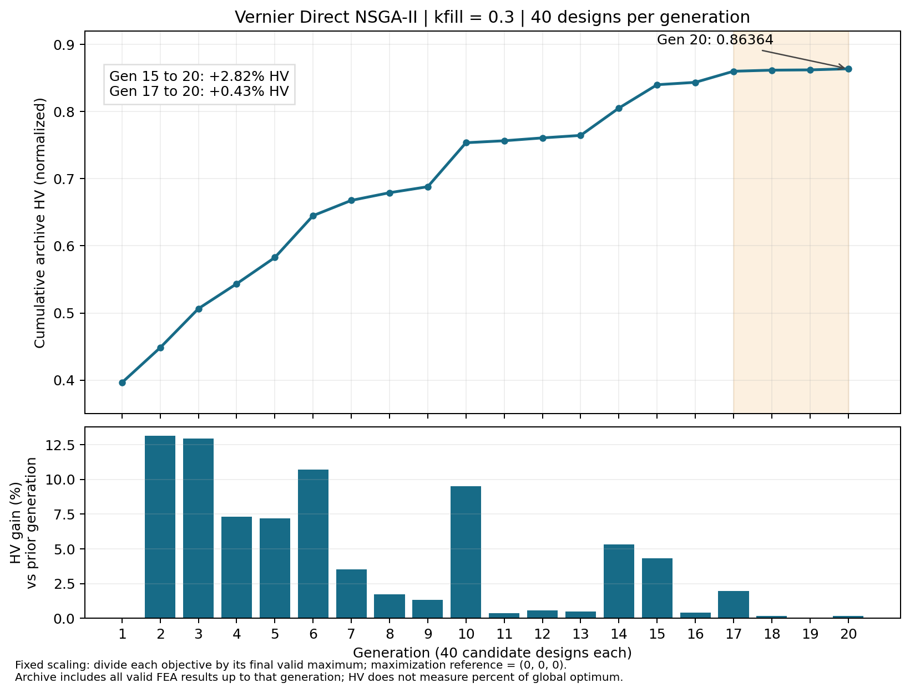

# Motor-CAD và Vernier: Exploratory DoE và Direct NSGA-II

Ngày cập nhật: 15/11/2026.

## Khôi phục hai model Ansys sau khi clone repo

Hai model nguồn được lưu nguyên byte dưới dạng [base.aedt.txt](<Verinier Ansys/base.aedt.txt>) và [base_half_main.aedt.txt](<Verinier Ansys/base_half_main.aedt.txt>). Bỏ đuôi `.txt` sẽ khôi phục đúng nội dung `.aedt`; đổi đuôi không nén hoặc giảm dung lượng. Bản `.aedt` dùng tại máy và cache `.aedtresults/` được Git ignore để tránh lưu trùng.

Có thể giữ nguyên bản TXT trong repo và tạo bản dùng cho Ansys bằng PowerShell tại thư mục gốc dự án:

```powershell
Copy-Item -LiteralPath 'Verinier Ansys/base.aedt.txt' -Destination 'Verinier Ansys/base.aedt'
Copy-Item -LiteralPath 'Verinier Ansys/base_half_main.aedt.txt' -Destination 'Verinier Ansys/base_half_main.aedt'
```

Các file này là model nguồn, không bao gồm kết quả solver cũ. Runner hiện vẫn dùng `SOURCE_MODEL` tại `inspection/vernier_pilot_20261113/work/test_point/base_half.aedt`; đường dẫn local đó không được Git lưu. Khi dựng lại môi trường sau clone, cần chọn model nguồn đã khôi phục trong `SOURCE_MODEL` hoặc chép model vào đúng đường dẫn local, rồi tạo worker cho chiến dịch mới. Tương tự, `TARGET_MODEL` trong script apply phải trỏ tới model test muốn sửa. Không thay nguồn của một chiến dịch đang resume.

## Quyết định hiện tại

Vernier đã hoàn tất Direct NSGA-II với `kfill=0.3`: 20 thế hệ, 800 thiết kế, 751 lượt FEA, 706 thiết kế hợp lệ và 93 điểm Pareto. Tỷ lệ lỗi geometry/mesh sau khi qua ràng buộc là **26/751 = 3,46%**. Xem [kết quả và phân tích HV](#kết-quả-vernier-direct-nsga-ii-kfill03--15112026) ở cuối tài liệu. Các mục ngày 13–14/11 bên dưới ghi lại lịch sử triển khai; cấu hình hiện tại ở phần kết quả mới nhất được ưu tiên.

Người dùng chấp nhận kết quả thăm dò hiện tại để chuyển sang model Vernier mới. **Dừng thử nghiệm trên model SPM này; không chạy thêm test, seed, ngân sách hoặc FEA chỉ để cải thiện bảng kết quả.** Đây là quyết định chuyển giai đoạn nghiên cứu, không phải khẳng định phương pháp đã được chứng minh vượt trội trên mọi bài toán.

## Phần đã hoàn thành

- Tự động hóa Motor-CAD, biến rời rạc, kiểm tra J, quản lý cache/FEA records/checkpoint và chạy song song.
- Direct NSGA-II thực tế 800 FEA, đã được đối chiếu thủ công một số thiết kế trong Motor-CAD.
- Conventional ANN + NSGA-II; Adaptive Sequential G–G–L–L; Adaptive Alternating G–L–G–L.
- Hai chiến dịch chính theo quy ước mới: **pool 60 + 20 verification cuối** và **pool 100 + 20 verification cuối**, seed 17. Các FEA trong hai chiến dịch này đều hợp lệ.
- Báo cáo sai số trung bình/lớn nhất, RMSE/R², FEA archive Pareto, verified-subset Pareto/HV và chi phí. Các run/code/config dành riêng cho budget cũ đã được loại bỏ; chỉ giữ các kết quả chính và dữ liệu nguồn cần thiết.

## Thuật ngữ và cách đếm đã thực hiện

**Pool ANN gồm fitting + validation. Không gọi pool 100 là 100 điểm trực tiếp fit mạng.** Tám điểm validation cố định được dùng chọn checkpoint, không vào gradient fitting hoặc fit scaler. Cả ba phương pháp có cùng kích thước pool/fitting/validation tại cùng một mức.

| Pool cuối | Fitting | Validation | Verification cuối, không train lại | FEA tính ngân sách mỗi phương pháp |
|---:|---:|---:|---:|---:|
| 60 | 52 | 8 | 20 | 80 |
| 100 | 92 | 8 | 20 | 120 |

Conventional lấy đủ pool từ initial/DoE toàn miền, train một lần. Adaptive train initial và một lần ở mỗi stage. **Sau verification không train lại ngay**; kết quả đó chỉ đi vào training cùng DoE mới ở stage kế tiếp.

| Pool cuối | Initial | DoE bốn stage | Verification trung gian đi vào pool | Pool qua các lần train |
|---:|---:|---|---:|---|
| 60 | 20 | 7, 6, 6, 6 | 3 × 5 = 15 | 20 → 27 → 38 → 49 → 60 |
| 100 | 40 | 12, 11, 11, 11 | 3 × 5 = 15 | 40 → 52 → 68 → 84 → 100 |

Do đó Adaptive pool 60 = **45 initial/DoE + 15 verification cũ**; pool 100 = **85 initial/DoE + 15 verification cũ**. Không cộng verification trung gian hai lần. Verification cuối có 20 thiết kế mới, nằm ngoài toàn bộ pool và không dùng để train lại.

Initial được dùng chung chính xác trong mỗi chiến dịch, tái sử dụng từ dữ liệu initial đã kiểm chứng fingerprint/LHS. Chiến dịch pool 60 chạy thêm 180 solver calls; pool 100 chạy thêm 240 solver calls. Các initial tái sử dụng vẫn được tính vào ngân sách từng phương pháp. Không dùng bộ Direct800 cho training hoặc adaptive sampling. Nguồn initial nay nằm riêng tại `data/spm_initial20/` và `data/spm_initial40/`; calibration HV cố định tại `data/spm_hv_calibration.json`. CSV nguồn được sao chép nguyên vẹn và đối chiếu SHA256 trước khi xóa run cũ.

## Kết quả trên cùng thang HV cố định

Model đã thử là **SPM 18 slots/4 poles**, không phải model Vernier mới. Ba mục tiêu tối đa hóa: average electromagnetic torque `AvTorqueMsVw`, phasor PF `PhasorPowerFactor`, motor efficiency `MotorEfficiency`. Stator diameter 129.772 mm; stator/rotor/magnet lengths 100 mm; J = 7 A/mm²; tốc độ 1500 rpm. Đây là thiết lập của testbed cũ, không mặc định áp sang model mới.

HV archive dùng mọi điểm FEA thật đã có của phương pháp. HV verification20 chỉ dùng 20 điểm kiểm chứng cuối. Không đưa dự đoán ANN chưa kiểm chứng vào các HV này.

| Pool | Phương pháp | HV archive | HV verification20 |
|---:|---|---:|---:|
| 60 | Conventional | 1.050064 | 0.994969 |
| 60 | Sequential | 1.102307 | 1.095134 |
| 60 | Alternating | 1.098929 | 1.094071 |
| 100 | Conventional | 1.086135 | 1.067533 |
| 100 | Sequential | 1.125000 | 1.097108 |
| 100 | Alternating | 1.122135 | 1.099679 |

**Direct NSGA-II 800 FEA: HV = 1.147174**, là tham chiếu độc lập khác ngân sách, không phải Pareto ground truth.

Tất cả HV trên giữ nguyên calibration của báo cáo 100 FEA ban đầu: objective order Torque/PF/Efficiency; min = `[4.54883620411918, 0.884752904222439, 79.5612967771118]`; span = `[18.52456735421862, 0.11341821372885497, 11.529350551225392]`. Với mục tiêu maximize, `z=(y-min)/span`, `F=1-z`, reference = `[1.1,1.1,1.1]`. Không đổi calibration giữa các dòng hoặc trộn với bảng HV từng dùng calibration khác.

## Sai số verification20: trung bình và lớn nhất khác nhau

Đơn vị dưới đây là sai số tương đối tuyệt đối (%): `100 × abs(ANN − FEA) / abs(FEA)`. Mỗi ô ghi **trung bình / lớn nhất** trên 20 thiết kế mới của phương pháp đó.

| Pool | Phương pháp | Torque | PF | Efficiency |
|---:|---|---:|---:|---:|
| 60 | Conventional | 16.5929 / 32.4898 | 0.2073 / 0.3700 | 0.9783 / 1.7419 |
| 60 | Sequential | 12.4408 / 44.2177 | 0.5252 / 2.3646 | 0.7873 / 2.0571 |
| 60 | Alternating | 6.1224 / 20.7821 | 0.4917 / 1.2642 | 0.5978 / 1.5411 |
| 100 | Conventional | 9.7819 / 24.4201 | 0.3483 / 1.0337 | 0.6745 / 1.3244 |
| 100 | Sequential | 2.8286 / 10.5001 | 0.1429 / 0.4159 | 0.1755 / 0.5226 |
| 100 | Alternating | 2.9524 / 9.6607 | 0.1649 / 0.9771 | 0.2018 / 1.1471 |

Sequential pool 60 có **sai số torque trung bình thấp hơn Conventional**, dù sai số torque lớn nhất cao hơn. Không dùng outlier để phủ nhận kết quả trung bình; cũng không dùng trung bình để bỏ qua outlier. PF của Adaptive pool 60 có sai số trung bình cao hơn Conventional.

## Kết luận được giữ lại

- Trong các lượt seed 17 này, cả hai Adaptive tìm được tập FEA có HV tốt hơn Conventional ở cùng ngân sách mỗi mức.
- Ở pool 60, HV verification20 của hai Adaptive cao hơn Conventional khoảng 10%; HV verification20 cũng gần các giá trị tương ứng ở pool 100. Đây là tín hiệu thăm dò về hiệu quả lấy mẫu/tiết kiệm FEA đáng để chuyển sang bài toán động cơ mục tiêu.
- Chất lượng thiết kế tìm được và độ chính xác ANN là hai tiêu chí riêng. Adaptive không thắng mọi chỉ số dự đoán; đặc biệt pool 60 vẫn có sai số torque lớn tại một số điểm.
- Tập validation chỉ có 8 điểm và dùng chọn checkpoint; verification20 được chọn trên Pareto riêng của mỗi phương pháp. Chưa có tập test toàn miền chung độc lập hoặc kết quả nhiều seed. Không biến kết quả thăm dò thành tuyên bố vượt trội phổ quát.
- Không chạy thêm SPM để tìm seed đẹp hoặc làm bảng số liệu thuận lợi hơn. Người dùng quyết định chuyển sang Vernier tại đây.

## Bàn giao sang model Vernier

Tái sử dụng phần tự động hóa, cache/checkpoint, ANN và workflow đã chạy. **Không tự động tái sử dụng dữ liệu SPM làm dữ liệu huấn luyện Vernier**, không gộp archive hoặc so raw HV giữa hai động cơ. Model mới cần danh tính/config/fingerprint và thư mục dữ liệu riêng.

Trước triển khai model mới cần có file model và định nghĩa biến/ràng buộc/điều kiện vận hành của Vernier. Không mặc định giữ 7 biến, giới hạn, chiều dài 100 mm, cấu hình winding hay công thức kiểm tra J của SPM cho Vernier. Chỉ rà soát những phần phụ thuộc model mới; không mở lại chiến dịch test hoặc FEA SPM. Chưa khởi chạy hoặc sửa model Vernier trong bước chốt tài liệu này.


## Làm rõ ràng buộc Vernier (13/11/2026)

Tài liệu ràng buộc: [Vernier_Model_Constraints.txt](Vernier_Model_Constraints.txt). Người dùng đã xác nhận `sta_yoke` trong biểu thức khoang dây trong chính là `sta_yoke_thickin` (chiều dày gông stator trong), không phải biến độc lập khác.

Giữ phần cộng thêm `0.02 * Pout` trong mẫu số hiệu suất hiện có: `Pout * 1.02 + p_cu + CoreLoss + SolidLoss`. Đây là giả thiết excess loss bổ sung được người dùng chấp nhận; không gọi riêng là tổn hao cơ hoặc tổn hao đã được FEA tính trực tiếp. Cửa sổ lấy trung bình và cách tổng hợp hiệu suất vẫn cần được kiểm tra khi triển khai.

The user confirmed all 13 bounds listed in Vernier_Model_Constraints.txt and code/vernier_model.py. Geometry screening now uses 100 points in those agreed bounds; it does not automatically change the domain. Keep the existing eff expression and average it over the final electrical cycle, consistently with Torque/PF.

Kiểm tra kết nối chỉ đọc ngày 13/11/2026: COM `Dispatch("Ansoft.ElectronicsDesktop.2024.1")` kết nối được Ansys 2024.1.0, project `base`, design `VM_6_28`; đọc được 36 biến, diện tích bốn đối tượng dây và waveform trực tiếp bằng `GetSolutionDataPerVariation`, không cần Excel. Phiên kiểm tra có `kfill = 0.3`, `Ip = 8.67A * sqrt(2)`; đây là kết quả cũ, chưa phải lần chạy với quy ước J/kfill mới. Trên cửa sổ `[1/fs, 2/fs]`, `fs = 210 Hz`, trung bình theo thời gian của `eff` là 87.32958185%, tỷ số các công suất trung bình là 87.33065432% (lệch khoảng 0.00107247 điểm phần trăm tại base). Khi đọc waveform phải chuyển sang SI: API mặc định có thể trả Time bằng ns và CoreLoss bằng mW. Kiểm tra này không thay biến, lưu model hay chạy FEA; vòng tự động cập nhật hình học/dòng rồi solve vẫn chưa được kiểm chứng từ đầu đến cuối.

## Chạy Direct NSGA-II Vernier trước ANN

Hậu xử lý: đọc lại đúng cached variation của điểm 7 trong lượt 10 điểm cho thấy torque trung bình -0.562386 Nm, dòng và J khớp giá trị đã đặt. Assertion cũ gộp torque/efficiency/PF thành lỗi không có thông báo; đây là điểm ngoài miền mục tiêu motoring hiện tại, không phải bằng chứng lỗi đọc đơn vị. Code mới phân biệt `operating_point_infeasible`, giữ raw metrics/waveform và không đưa điểm đó vào Pareto hợp lệ. Solver state được Save ngay sau khi solve thành công, trước hậu xử lý; lỗi hậu xử lý khác có thông báo và traceback. Chưa kết luận ba điểm 1/8/9 có cùng nguyên nhân vì chưa truy xuất lại được cached variation tương ứng. Không chạy lại FEA để thực hiện việc chẩn đoán này.

Thử một điểm bằng tay: mở `code/apply_vernier_point.py`, chọn `POINT_ID=5` hoặc `3`, rồi Run để truyền toàn bộ tham số vào một worker hiện có (worker đầu tiên trong pool) và để model mở cho kiểm tra. Với điểm tùy ý, dán dictionary vào `CUSTOM_POINT` và chọn `POINT_ID='custom'`; có thể chỉ nhập các biến muốn đổi, các biến thiết kế còn lại lấy lại từ base. Ba biến phụ thuộc được tính tự động, vẫn cho nhập đè khi cần debug. Có `I_rms` trong dictionary thì dùng đúng dòng đó; nếu bỏ thì đọc diện tích và tính theo J. Mặc định `RUN_FEA=False`, `SAVE_MODEL=False`: không solve, không lưu đè file; không tạo bản sao mới và không dùng base_backup. Hai preset 3/5 khớp dữ liệu đã áp trong lượt FEA check. Script này không chặn điểm hình học xấu vì mục đích là xem chính các điểm lỗi, không tự thu miền hoặc sửa hình học.

**Chẩn đoán mesh sau lượt NSGA-II đầu:** log có `Edge is not preserved in the mesh` và `TAU: Surface Mesh Generation Failed`. Đọc trực tiếp cả năm worker cho thấy `CylindricalGap1` đã xuất hiện lại dù cờ `initialized` là true. Vì vậy mesh policy version 2 kiểm tra danh sách operation thực tế sau cập nhật hình học và sau Save; chỉ xóa đúng `CylindricalGap1` nếu có, rồi xác nhận nó không còn trước khi gọi solver. Cờ khởi tạo không thay thế kiểm tra này. Geometry Validation Check không bảo đảm mesh sẽ thành công.

File Run hiện mặc định `MODE='fea_check'`: lấy đúng 10 ứng viên đầu từ kế hoạch NSGA-II lỗi để kiểm tra, ngân sách tối đa 10 solver calls, kết quả chung tại `runs/vernier_fea_check/`. Không tự chạy lại 800 điểm. Dừng lượt cũ bằng Ctrl+C một lần và chờ solver hoàn tất trước khi Run lại; khóa dùng chung sẽ chặn hai chương trình cùng sửa worker. Bản sửa mới chỉ qua kiểm tra offline, chưa chứng minh hết lỗi mesh. Sau khi kiểm tra đạt mới chuyển `MODE='nsga2'`; mặc định baseline mới dùng `runs/nsga2_vernier_v3/` để không nạp cache lỗi cũ làm kết quả tối ưu. Log và dữ liệu lượt v2 vẫn được giữ nguyên.

Geometry v2 has completed: 100/100 geometry_ok, no solver calls; the user reviewed the recorded geometry. The Run entry now defaults to MODE='nsga2' for the independent Direct NSGA-II baseline. No NSGA-II FEA was launched while changing this setting.

**Bổ sung ràng buộc version 2:** sau khi xem video, người dùng thêm `Dsin/2 - (Dsin/2 - slot_d_axin - slot_tipin)/cos(slot_ang_axin) > slot_d_axin` để ngăn dây trong chèn vào split tooth. Góc tính theo độ. Rà lại bằng công thức cho thấy 85/100 điểm geometry cũ thỏa, 15 điểm vi phạm (ID 2, 7, 20, 27, 36, 42, 43, 47, 58, 73, 74, 87, 89, 90, 97). Không dùng kết luận 100/100 của bộ ràng buộc cũ cho version mới. Các cận biến giữ nguyên; mặc định kết quả mới vào `runs/vernier_geometry_v2/` và `runs/nsga2_vernier_v2/`, dùng lại cùng năm worker. Fingerprint có phiên bản ràng buộc để tránh resume nhầm dữ liệu cũ. Chưa chạy lại CAD/FEA sau bổ sung này.

Thứ tự đã chốt: **DOE kiểm tra hình học (không FEA) → xem lỗi CAD trong miền đã chốt → Direct NSGA-II + FEA thật để lấy Pareto baseline độc lập → sau đó mới nghiên cứu Conventional/Adaptive ANN**. DOE hình học không phải initial DOE để train ANN. Khởi tạo population của NSGA-II dùng LHS lọc bất đẳng thức; đây là population của tối ưu trực tiếp, không phải bộ train ANN.

Mở [code/run_vernier_nsga2.py](code/run_vernier_nsga2.py), chọn interpreter `.venv/Scripts/python.exe`, bấm **Run Python File**. Hoặc chọn cấu hình Vernier trong Run and Debug rồi F5. File này có hai chế độ, **`MODE='geometry'`: 100 điểm chỉ kiểm tra CAD/Validation/diện tích/dòng, không chạy FEA**; kết quả vào `runs/vernier_geometry_v2/`. Sau khi kiểm tra lỗi hình học, đổi `MODE='nsga2'` để chạy Direct NSGA-II. Cấu hình NSGA-II giống chiến dịch Direct Motor-CAD: population 40, 20 thế hệ, ngân sách cứng tối đa 800 solver calls, seed 17, năm worker. Vernier dùng 13 biến liên tục với khoảng riêng; không dùng giới hạn hay dữ liệu SPM. Hai chế độ không tự chuyển tiếp sang nhau.

Mỗi ứng viên được kiểm tra ràng buộc, cập nhật CAD, Validation Check, đọc diện tích và tính lại dòng trước khi solve. Điểm hình học/solver lỗi được ghi lại và loại bằng constraint violation của thuật toán; không lưu mục tiêu FEA giả bằng 0. Năm worker dùng lại các model hiện có. ANN không tham gia chọn nghiệm hoặc tính mục tiêu.

Kết quả gom trong `runs/nsga2_vernier_v2/`: `evaluations.sqlite`, một `results.xlsx` chung (Results/Waveforms), `results.csv`, `pareto.csv`/`pareto.json` từ mọi FEA hợp lệ và `nsga2_checkpoint.dill`. Pareto này là baseline FEA độc lập, không phải ground truth. Chưa áp calibration HV của SPM cho Vernier.

Bấm Run lại để tiếp tục từ checkpoint; offspring đang chờ và RNG được lưu trước khi gọi solver. Điểm đã đánh giá được lấy từ cache, không gọi FEA lại. Lần thử solver lỗi hoặc bị gián đoạn vẫn tính ngân sách. Có thể tăng `MAX_FEA_CALLS` để tiếp tục khi đã hết ngân sách; nếu đổi population/thế hệ/seed/khoảng biến/model nguồn, dùng RUN_DIR khác hoặc khôi phục thiết lập cũ. Chỉ mở checkpoint do chính dự án này tạo.

Ctrl+C một lần ngừng gửi điểm mới và chờ solver đang chạy; lần Run sau tiếp tục thế hệ đang dở. Đóng workbook để cập nhật Excel; SQLite vẫn giữ dữ liệu nếu Excel khóa file. Các file chính chỉ gồm `run_vernier_nsga2.py` (Run/thiết lập), `vernier_optimize.py` (NSGA-II, điều phối, lưu kết quả), `vernier_model.py` (hình học/model/waveform); `test_vernier.py` dành cho kiểm thử offline. Các tên entry DOE cũ đã được thay để tránh chạy nhầm. Phiên bản NSGA-II này mới được kiểm tra offline; chưa gọi FEA mới trong lần sửa kế hoạch.
## Quy ước J cho Vernier dual stator

Khởi tạo model mới: theo script người dùng ghi tại `Verinier Ansys/mesh_delete.py`, xóa mesh operation tự sinh `CylindricalGap1` bằng `oDesign.GetModule("MeshSetup").DeleteOp(["CylindricalGap1"])` một lần trước lần solve đầu tiên. Không xóa hình học, không gọi lại cho mỗi lần đổi tham số trên cùng model. Sau bước này, baseline và năm điểm pilot đã solve thành công.

Pilot ngày 13/11/2026: baseline đạt Torque 9.612713 Nm, PF 0.352323, hiệu suất 86.409502% với `I_rms = 11.530735 A`, `J_in = 5.5`, `J_out = 4.656102` A/mm². Năm project bản sao chạy đồng thời bằng `Analyze("Setup1", False)` trong cùng một phiên AEDT; gồm `slot_thickin = 3/12 mm`, `slot_thickout = 5/28 mm` và một điểm thay đổi phối hợp hình học. Cả năm thành công; không cần mở năm phiên GUI riêng. Thời gian từ lúc launch điểm đầu đến khi thu đủ kết quả khoảng 6.6 phút. Đây là kiểm tra đường chạy FEA tại sáu điểm, chưa phải kiểm chứng toàn miền, hội tụ mesh/time step hoặc ANN 13 biến.

Dữ liệu pilot được lưu chung tại `inspection/vernier_pilot_20261113/evaluations.sqlite`; [báo cáo pilot](inspection/vernier_pilot_20261113/REPORT.md) và workbook pilot cũ (đã xóa cùng thư mục outputs theo yêu cầu người dùng; không ảnh hưởng kết quả NSGA-II hiện tại). Có 606 mẫu waveform từ sáu thiết kế hợp lệ. Ledger vẫn giữ hai lần solver lỗi mesh trước khi bổ sung cleanup; tổng tám solver calls, không biến lỗi thành mục tiêu bằng 0. File nguồn `base.aedt` và các kết quả SPM không bị sửa.

Code Vernier is now centralized in `code/run_vernier_nsga2.py`, `code/vernier_optimize.py`, and `code/vernier_model.py`. The old scripts in inspection/ were retired. The runner reuses the existing five models recorded by the pilot manifest; full parameter snapshots and waveforms remain in SQLite, while worker model files retain their latest state. No additional FEA was run for this code migration.

Model tham chiếu: `Verinier Ansys/base.aedt`, design `VM_6_28`. Đã đọc diện tích trực tiếp qua Ansys Modeler, không chạy FEA. Quy ước thống nhất cho bước triển khai tiếp theo: **hai stator dùng chung một dòng RMS; cả `J_in` và `J_out` đều không vượt 5,5 A/mm², không yêu cầu bằng nhau.** Không cần tách hai nguồn chỉ để đáp ứng ràng buộc J này.

Theo công thức `Js_in`/`Js_out` hiện có trong model, định nghĩa diện tích hình học hiệu dụng (chưa nhân hệ số lấp đầy):

```text
A_in  = 2 * Area(coil_in_1)  + Area(Circle12)
A_out = 2 * Area(coil_out_1) + Area(Circle10_Separate1)

J_in  = 2 * Ntc     * I_rms / (kfill * A_in)
J_out = 2 * Ntc_out * I_rms / (kfill * A_out)

I_limit_in  = J_max * kfill * A_in  / (2 * Ntc)
I_limit_out = J_max * kfill * A_out / (2 * Ntc_out)
I_rms = min(I_limit_in, I_limit_out)
Ip = sqrt(2) * I_rms
```

Trong các công thức trên, diện tích dùng **mm²**, dòng dùng **A**, `J_max = 5.5` A/mm²; `Ntc`/`Ntc_out` là số vòng tương ứng trong model. Model hiện dùng chung `kfill` cho hai stator. Với cách chọn dòng này, stator giới hạn đạt J tối đa, stator còn lại có J thấp hơn hoặc bằng giới hạn.

Sau mỗi lần thay đổi tham số hình học: cập nhật hình học → đọc lại diện tích của bốn đối tượng → tính dòng chung → cập nhật kích thích → chạy FEA và lưu diện tích/dòng/J của cả hai stator. Không dùng cố định diện tích của base model cho mọi thiết kế. Nếu diện tích không hợp lệ hoặc không đọc được thì dừng đánh giá thiết kế đó, không dùng lại diện tích cũ.

Giá trị đã đọc ở hình học tham chiếu:

| Đối tượng | Diện tích (mm²) |
|---|---:|
| `coil_in_1` | 84.8180515575 |
| `Circle12` | 123.8735141074 |
| `coil_out_1` | 183.7709098514 |
| `Circle10_Separate1` | 53.4594349886 |
| `A_in` | 293.5096172223 |
| `A_out` | 421.0012546914 |

Tại thời điểm đọc, project đang mở có `kfill = 0.4`, còn file `.aedt` đã lưu có `kfill = 0.3`; các biến hình học đã đối chiếu khớp nhau. Tài liệu ràng buộc mới đã chốt **giữ cố định `kfill = 0.4`**. Khi triển khai phải thiết lập và đọc lại để xác nhận giá trị này trên model thực sự dùng cho lần chạy, rồi dùng giá trị đã xác nhận để tính dòng/J. Không dùng kết quả cũ với `kfill = 0.3` như dữ liệu cùng điều kiện.

Trong đợt kiểm tra performance này, người dùng quyết định **không áp ràng buộc điện áp**. Runner tính lại dòng theo J sau mỗi lần đổi hình học và ghi waveform điện áp để tham khảo; không loại điểm chỉ vì điện áp cao. Phần tính dòng/đọc waveform đã có trong `code/vernier_model.py`.

## Nơi lưu bằng chứng

Các thư mục `runs/` được đưa lên Git, gồm dữ liệu FEA, kết quả, checkpoint ANN/NSGA-II, log, báo cáo và biểu đồ. File model Motor-CAD (`.mot`, `.bak`) và thư mục solver `work/` được giữ trên máy local vì dung lượng lớn. Khi chạy mô phỏng trên máy khác, cần cung cấp model Motor-CAD phù hợp và cập nhật đường dẫn trong cấu hình.

- [Báo cáo pool60 + verification20](runs/ann_pool60_ver20_seed17/REPORT.md)
- [Báo cáo pool100 + verification20](runs/ann_pool100_ver20_seed17/REPORT.md)
- [So sánh pool60–100, cùng calibration](runs/ann_pool60_vs100_ver20_seed17/REPORT.md)
- [Direct NSGA-II800 summary](runs/nsga2_L100_20261112_130156_685894/summary.json)
- Các thư mục run lưu `comparison.json`, `correctness_audit.json`, CSV FEA, ANN checkpoint, metrics từng stage, verification từng điểm, log và biểu đồ. Raw files được giữ nguyên để chuyên gia kiểm tra lại.

## Mã và cấu hình đang giữ

- `code/ann_campaign.py`: chương trình Conventional/Adaptive, chỉ giữ quy ước pool + verification cuối riêng.
- `code/motorcad_optimize.py`: Motor-CAD adapter, cache/ledger, DoE và phân tích kết quả.
- `code/nsga2_motorcad.py`: Direct NSGA-II.
- `code/test_*.py`: kiểm thử offline hỗ trợ bảo trì, không tham gia mô phỏng thông thường; không chạy lại trong lần dọn này.
- `config/ann_pool60_ver20_config.json`, `config/ann_pool100_ver20_config.json`: các cấu hình SPM chính đã thực hiện.
- `config/motorcad_config.json`, `config/nsga2_config.json`: cấu hình kết nối/model SPM hiện tại.
- `data/`: initial và calibration HV đã tách khỏi các run budget cũ. Metadata nguồn được giữ để truy xuất.

Các đường dẫn cấu hình và manifest của hai run chính đã chuyển sang nguồn `data/`; `cleanup_migration.json` ghi nhận việc chuyển đường dẫn. Không thay đổi FEA CSV, ANN checkpoint hay giá trị metrics của các run chính. Đây không phải cấu hình Vernier mới; chỉ tiếp tục triển khai khi có model Vernier.


## Lịch sử thử Vernier half-model — 14/11/2026

- Source/test file: `inspection/vernier_pilot_20261113/work/test_point/base_half.aedt`, design `VM_6_28`. The copy under `Verinier Ansys/` is not selected.
- `code/apply_vernier_point.py` edits this disposable test file directly, never a worker. `POINT_ID` selects a preset or `custom`; `SAVE_MODEL=False`, `RUN_FEA=False` by default. The original `base.aedt` is only read as the fixed geometry anchor for dependent dimensions; it is never edited. Saving manual changes to the source after starting a campaign invalidates its fingerprint.
- `code/run_vernier_nsga2.py` defaults to `MODE='fea_check'`: 10 FEA points. It creates exactly five `half_worker_01` through `half_worker_05` clones in `runs/vernier_half_workers/work/` on first Run and reuses that pool in all modes. The old five workers and full-model archives are not used. Ansys opens the new clones through COM; no manual pre-opening is required.
- Outputs: `runs/vernier_half_fea_check/`, `runs/vernier_half_geometry/` (100 geometry checks), or `runs/nsga2_vernier_half/` (`MODE='nsga2'`, population 40, generations 20, budget 800). Results remain consolidated per campaign.
- The saved half model passed `ValidateDesign`; all four coil-area queries succeeded. No FEA was launched during this code update. Its saved `Multiplier=2` and periodic boundaries are preserved; mesh, waveform validity, and physical equivalence still require FEA. Code adds no extra factor of two.
- If the source is replaced after pool creation, the fingerprint guard stops reuse. Start a fresh campaign and pool by changing the corresponding output directories rather than mixing results from different models.


## Kết quả Vernier Direct NSGA-II kfill=0.3 — 15/11/2026

Đã hoàn tất **20 thế hệ × 40 cá thể = 800 thiết kế duy nhất**, dừng do đủ thế hệ. Có **751 lượt FEA thực tế**, chưa chạm trần ngân sách 800 lượt; 49 ứng viên bị lọc bằng ràng buộc hình học trước FEA. Đây là baseline Direct NSGA-II độc lập, chưa phải nghiên cứu ANN cho Vernier.

### Cấu hình và cách chạy hiện tại

- Entry: [code/run_vernier_nsga2.py](code/run_vernier_nsga2.py), `MODE='nsga2'`, population 40, generations 20, seed 17, tối đa 800 lượt FEA, 5 worker.
- Model nguồn/test: `inspection/vernier_pilot_20261113/work/test_point/base_half.aedt`, design `VM_6_28`. Dùng nửa mô hình với thiết lập multiplier đã lưu; code không nhân thêm hệ số hai.
- Tái sử dụng 5 worker tại `runs/vernier_half_workers_v5/work/`; không tạo model mới cho mỗi điểm.
- `K_FILL=0.3` trong [code/vernier_model.py](code/vernier_model.py). Mỗi điểm áp lại kfill và tính dòng từ diện tích dây thực tế để cả hai stator có **J ≤ 5,5 A/mm²**. Khoang dây trong và ngoài đều phải **> 1 mm**; giữ 13 biến và khoảng biến đã chốt.
- Torque, PF và eff lấy trên chu kỳ điện cuối. Giữ trung bình của eff(t), gồm phần excess loss `0.02*Pout`; không áp ràng buộc điện áp. Điểm hợp lệ cần **torque > 0, 0 < PF < 1, 0 < eff < 1**; eff trong bảng kết quả được ghi bằng phần trăm.
- Lượt `kfill=0.3` có thư mục và fingerprint riêng, không trộn kết quả hoặc checkpoint của `kfill=0.4`.

Giữ nguyên `RUN_DIR` rồi Run sẽ resume checkpoint; các điểm đã hoàn tất không được đánh giá lại. Ngân sách tính cả lượt solve fail hoặc bị ngắt sau khi bắt đầu FEA. Nếu muốn chạy lại từ đầu trong cùng tên thư mục: dừng runner, chờ Ansys hết solve rồi xóa riêng `runs/nsga2_vernier_half_kfill03/`; giữ thư mục worker. Không mở hai runner cùng dùng worker.

### Kết quả và định nghĩa tỷ lệ lỗi

| Phân loại | Số thiết kế |
|---|---:|
| Hợp lệ cho cả ba mục tiêu | 706 |
| Solve được nhưng vi phạm ràng buộc vận hành | 19 |
| TAU mesh failed | 22 |
| Solver không xác định được đường bao kín | 4 |
| Vi phạm ràng buộc hình học, lọc trước FEA | 49 |
| Tổng | 800 |

Trong 19 điểm ngoài miền vận hành, 11 bị loại vì torque không dương; 8 còn lại vì điều kiện eff/PF. Những điểm này vẫn solve và đọc được dữ liệu, **không tính là lỗi geometry/mesh**. Tương tự, 49 điểm vi phạm các bất đẳng thức hình học không được tính là lỗi Ansys.

Theo cách đếm đã thống nhất, **lỗi FEA sau khi qua ràng buộc = (22 + 4)/751 = 3,46%**. Có **725/751 = 96,54%** điểm solve thành công, trong đó 706 điểm đạt điều kiện vận hành. Không ghi nhận overlap, lỗi chọn project/COM hay lỗi hậu xử lý trong lượt hoàn tất này.

Bốn điểm lỗi đường bao là **356, 491, 543, 718**. Ansys báo không tìm được chu vi vật thể kín và nêu khả năng kích thước chi tiết quá nhỏ; chưa xác định chính xác cạnh gây lỗi. Các preset này đã được gán vào [code/apply_vernier_point.py](code/apply_vernier_point.py), giữ đúng kích thước, kfill và dòng đã áp trong lượt chạy; script chỉ sửa model test, mặc định không save/solve.

### Cực đại và Pareto

Chỉ xét 706 thiết kế hợp lệ. Ba cực đại thuộc ba thiết kế khác nhau:

| Điểm | Cực đại | Torque (Nm) | PF | Eff (%) |
|---|---|---:|---:|---:|
| 660 | Torque cao nhất | **10,202765** | 0,630006 | 89,644848 |
| 466 | PF cao nhất | 0,485685 | **0,995260** | 86,781666 |
| 469 | Eff cao nhất | 0,402501 | 0,958832 | **92,758336** |

Tập Pareto tích lũy có **93 thiết kế FEA hợp lệ**. PF/eff cực đại đi kèm torque thấp; thiết kế 660 đạt torque lớn hơn trong khi vẫn có PF ≈ 0,63 và eff ≈ 89,64%. Không có một thiết kế đồng thời đạt cả ba cực đại.

### Diễn biến HV

Tính lại HV của **archive tích lũy các thiết kế FEA hợp lệ**, không chỉ quần thể đang sống. Mỗi thế hệ ứng với 40 ID thiết kế liên tiếp; lượt này có đúng 800 thiết kế duy nhất qua 20 thế hệ.

Dùng cùng thang chuẩn hóa cho toàn bộ lịch sử: chia torque, PF, eff lần lượt cho các cực đại cuối lượt **(10,202764865941374 Nm; 0,995260120277639; 92,75833588390243%)**, điểm tham chiếu trong không gian cực đại hóa là **(0, 0, 0)**. Các giá trị và toàn bộ lịch sử được lưu trong [hv_analysis.json](runs/nsga2_vernier_half_kfill03/hv_analysis.json). Đây là chuẩn hóa hậu nghiệm để phân tích nội bộ lượt này; nếu so sánh lượt khác phải giữ cố định các thang và điểm tham chiếu này. Không so trực tiếp với HV của nghiên cứu SPM/ANN cũ.

| Thế hệ | HV archive chuẩn hóa |
|---:|---:|
| 1 | 0,396320 |
| 10 | 0,753544 |
| 15 | 0,839919 |
| 17 | 0,859971 |
| 20 | 0,863640 |

- Thế hệ 10 → 20: tăng HV tương đối **14,61%**.
- Thế hệ 15 → 20: tăng **2,82%**.
- Thế hệ 17 → 20: tăng **0,43%**.
- Thế hệ 19 → 20: tăng **0,19%**.



Nhận xét: mức cải thiện giảm rõ ở cuối lượt; tập Pareto hiện tại đủ làm baseline so sánh cho giai đoạn tiếp theo. Tuy nhiên, chỉ ba thế hệ cuối tăng ít chưa chứng minh hội tụ toàn cục hoặc không còn vùng tốt hơn, nhất là khi vẫn có vùng mesh thất bại. **HV = 0,863640 không có nghĩa đạt 86,364% tối ưu.** HV phụ thuộc cách chuẩn hóa và điểm tham chiếu; xem [tài liệu pymoo về phân tích hội tụ](https://pymoo.org/getting_started/part_4.html).

### Dữ liệu kết quả

Toàn bộ nằm trong [runs/nsga2_vernier_half_kfill03/](runs/nsga2_vernier_half_kfill03/):

- `evaluations.sqlite`: ledger, attempts, mục tiêu, thông báo lỗi và waveform đã thu được.
- `results.xlsx`, `results.csv`: bảng kết quả chung; workbook có sheet Results và Waveforms.
- `pareto.csv`, `pareto.json`: 93 thiết kế Pareto từ FEA hợp lệ.
- `nsga2_summary.json`, `summary.json`: số thế hệ, số thiết kế, lượt FEA và phân loại trạng thái.
- `hv_analysis.json`, `hv_convergence.png`: cách chuẩn hóa, lịch sử HV và đồ thị.
- `nsga2_checkpoint.dill`: checkpoint để tiếp tục khi bị ngắt; chỉ nạp checkpoint do dự án này tạo.
